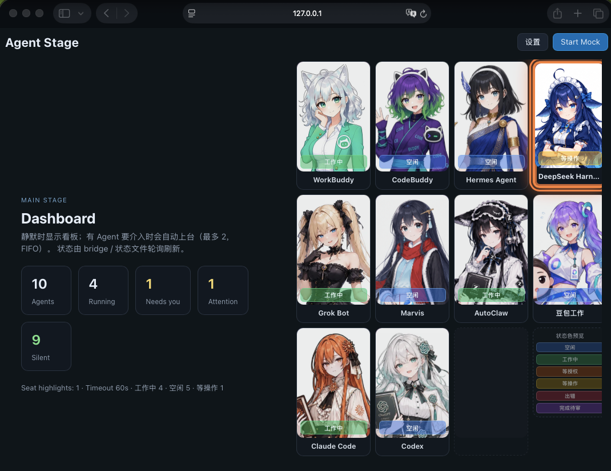

# Agent Stage（多 Agent 状态舞台）

> 一眼看到本机各编码 Agent 在干嘛的桌面看板：二次元立绘、主舞台 + 坐席、可插拔状态适配器。  
> Glanceable multi-agent status board — **Tauri 2** + **React / Vite**.

中文为主 · English terms kept where useful

---

## 这是什么 · What

常驻小窗 / 副屏看板：各厂商 Agent 是在跑、等授权、等操作，还是完成待审。  
用角色立绘按状态表现；需要人介入时上台到主舞台，超时退回坐席并保持呼吸光。

**默认不依赖云账号。** 浏览器 Demo 用 `public/status/*.json`；真实直播状态靠本机 **macOS poller**（需本地已安装对应 Agent 应用）。



## 功能 · Features

- 主舞台 + 坐席条（bottom / left / right 真改布局）
- 可配置角色立绘（六态 + offline）与座位顺序
- 统一状态快照协议 v1（`FileStatusAdapter` / `statusUrl`）
- macOS 直播轮询：`pnpm bridge:live`（写入 `~/.agent-stage/status/` 并镜像到 `public/status/`）
- 设置持久化：浏览器 `localStorage`，Tauri `app_data_dir/config.json`
- Mock / 文件 / 部分厂商 Jobs bridge（见 docs）


## 前置 · Prerequisites

| 用途 | 要求 |
|------|------|
| Web / Vite | **Node.js 20+**、**pnpm 9+** |
| Tauri 桌面窗 | 另需 **Rust**（rustup，建议 ≥1.90） |
| macOS 直播状态 | 本机已装对应 Agent；`sqlite3` / `curl`（一般自带） |
| Linux Tauri | 见下方系统库 |

直播 poller **面向 macOS**（读 `~/Library/...`、`.app/Contents/MacOS/...`）。在 Linux/Windows 上可先跑 UI + Mock / 手写 status JSON。

## 快速开始 · Quick start

```bash
git clone https://github.com/gaomails2024/agent-stage.git
cd agent-stage
pnpm install
pnpm dev          # http://localhost:5173 — 打开「设置」
```

可选桌面壳：

```bash
pnpm tauri:dev    # 或 pnpm tauri dev
```

检查：

```bash
pnpm typecheck
pnpm smoke
pnpm build
```

### Linux Tauri 依赖

```bash
sudo apt install pkg-config libwebkit2gtk-4.1-dev libgtk-3-dev librsvg2-dev patchelf
```

## 演示状态 · Demo status files

仓库里的 `public/status/*.json` 是**安全的 idle / demo 占位**，不是真实会话导出。  
改文件并保存后，File 适配器会驱动舞台（无需 Start Mock）：

```bash
pnpm exec tsx scripts/write-status.ts --id demo --status needs_input --summary "approve?" --out public/status/demo.json
```

Claude Code 示例 hook：`examples/hooks/claude-status-write.sh`。

## macOS 直播状态 · Live poller

第二个终端：

```bash
pnpm bridge:live          # 循环
pnpm bridge:live:once     # 单次
# 等价：node scripts/bridges/macos-live-status-poll.mjs
```

然后硬刷新 Vite 页面。各坐席保真度与已知缺口见 **[docs/LIMITATIONS.md](docs/LIMITATIONS.md)**；逐步说明见 **[docs/macos.md](docs/macos.md)**。

高层机制：poller 用进程白名单判断 online/offline，再读各产品本地 DB / session / 官方小接口映射到六态，原子写入：

- `~/.agent-stage/status/<id>.json`
- `<repo>/public/status/<id>.json`（给浏览器 `/status/…`）

## 设置与持久化 · Settings

顶部 **设置** 主路径只配 UI：坐席、背景、超时、坐席侧、卡宽、每角色状态图。  
适配器 / Jobs token / 自定义状态在 **高级**。

默认名单（代码 `DEFAULT_ROSTER_SPEC`，约 10 席）：WorkBuddy、CodeBuddy、Hermes、DeepSeek Harness、Grok Bot、Marvis、AutoClaw、豆包工作、Claude Code、Codex。

`public/config.override.json` 可带 `forceVersion`：版本字符串变化时**一次性**导入花名册到 localStorage / Tauri；之后你的 UI 修改会保留，直到下次 bump。

| 环境 | 存储 |
|------|------|
| Vite / 浏览器 | `localStorage` key `agent-stage-config` |
| Tauri 桌面 | `app_data_dir/config.json`（并镜像 localStorage） |

## 状态协议 · Status ingest

统一快照 JSON → `~/.agent-stage/status/<id>.json` 或配置 `statusUrl`。  
研究笔记与厂商对照：**[docs/status-ingest.md](docs/status-ingest.md)**。

可选 Jobs bridge（需本机 `--serve` + token）：

```bash
pnpm bridge:workbuddy -- --id workbuddy-1 --once
pnpm bridge:codebuddy -- --id codebuddy-1
```

## 打 Mac 包 · Pack for Mac

```bash
pnpm pack:mac          # → 仓库根目录 agent-stage-mac-*.tar.gz（可用 PACK_OUT_DIR=… 改输出）
# 拷到 Mac 后：
tar -xzf agent-stage-mac-*.tar.gz && cd agent-stage-mac-*
pnpm install && pnpm smoke && pnpm dev
```

完整步骤：[docs/macos.md](docs/macos.md)。

## 目录 · Layout

```
src/           React UI、adapters、config、舞台逻辑
src-tauri/     Tauri 2 + config 读写命令
scripts/       smoke、write-status、bridges（含 macos-live-status-poll）
public/        静态资源、角色立绘、status 占位、config.override
docs/          LIMITATIONS / macos / status-ingest / screenshots
examples/hooks/ Claude Code → 快照示例
.archify/      架构图产物（可选参考）
```

## 文档 · Docs

| 文档 | 内容 |
|------|------|
| [docs/signals.md](docs/signals.md) | 各 Agent 信号来源 / 忙闲 / 缺口（对照 poller 代码） |
| [docs/LIMITATIONS.md](docs/LIMITATIONS.md) | 保真度总表与已知缺口 |
| [docs/macos.md](docs/macos.md) | macOS 安装、poller、Jobs、hooks |
| [docs/status-ingest.md](docs/status-ingest.md) | 协议 v1 + 厂商调研 |
| [CONTRIBUTING.md](CONTRIBUTING.md) | 开发与加 adapter/bridge |

## License

[MIT](LICENSE)
